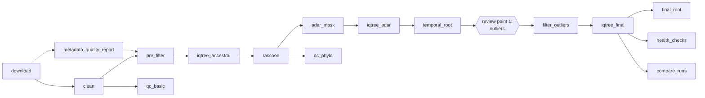

# BDBV Phylogenetic Pipeline

**Download, clean and build maximum-likelihood phylogenies from Bundibugyo ebolavirus (BDBV) genomes**

A [Nextflow](https://www.nextflow.io/) pipeline for downloading Bundibugyo ebolavirus (BDBV) genome sequences from [Pathoplexus](https://pathoplexus.org), cleaning and quality-checking them, handling ADAR-edited genomes, and building a temporally rooted maximum-likelihood tree. It can be run as an initial run on a fresh download, or as an update run that also compares the new dataset with a previous one. Every step runs in a Docker container by default. Based on [this](https://github.com/pekarj/bdbv-pipeline) original python pipeline.

## Running with GLACIER

This pipeline has been designed to be run in the interactive [GLACIER](https://github.com/ARTIC-Kraemer-Lab/GLACIER) GUI.

## Pipeline overview

The pipeline works through the following stages:

1. **Download** *(`download`)* — fetch the aligned sequences and metadata from Pathoplexus. Skipped if you provide `--fasta` and `--metadata`.
2. **Align** *(`mafft`, optional, `--mafft`)* — [MAFFT](https://mafft.cbrc.jp/alignment/software/) alignment, only needed for unaligned input. Pathoplexus sequences are already aligned.
3. **Clean** *(`clean`)* — rename headers, trim, mask any specified sites (`--mask_sites`), deduplicate versions, standardise locations using the aliases file and apply the date filter.
4. **Basic QC** *(`qc_basic`)* — genome-level QC report.
5. **Metadata quality report** *(`metadata_quality_report`)* — check the Pathoplexus metadata for duplicate samples, location and date problems and sequence quality failures, and list non-consortium sequences. Writes an automatic exclusion list (`exclude_auto.txt`). With the optional INRB linelist (`--linelist`), duplicates are also resolved against it and date/location mismatches with the linelist are flagged; without it, duplicates are flagged as unresolved (the higher-completeness accession is kept for now) and the linelist checks are skipped.
6. **Pre-filter** *(`pre_filter`)* — remove sequences in the manual, automatic and pending exclusion lists. The manual and automatic lists are also saved merged as `exclude_merged.txt`.
7. **Initial tree** *(`iqtree_ancestral`)* — [IQ-TREE](http://www.iqtree.org/) ML tree with ModelFinder (or a fixed `--model`) and ancestral state reconstruction.
8. **ADAR identification** *(`raccoon`)* — identify ADAR-edited sites with [raccoon](https://github.com/artic-network/raccoon).
9. **ADAR handling** *(`adar_mask`)* — mask the ADAR sites, or exclude affected genomes (`--adar_mode`).
10. **Phylogenetic QC** *(`qc_phylo`)* — phylogeny-based QC report.
11. **Rebuild tree** *(`iqtree_adar`)* — IQ-TREE on the ADAR-handled alignment, using the model found in step 7.
12. **Temporal rooting** *(`temporal_root`)* — best-fitting temporal root and outlier detection (**review point 1**).
13. **Outlier removal** *(`select_outliers`, `filter_outliers`)* — remove temporal outliers, either automatically or from a file you have reviewed (**review point 1**).
14. **Final tree** *(`iqtree_final`, `final_root`)* — final ML tree with aBayes branch support, temporally rooted.
15. **Health checks** *(`health_checks`, update runs only)* — compare with a previous dataset and flag problem genomes; a run comparison (`compare_runs`) summarises what changed.



## Output files

All outputs are written under `--outdir`, one folder per step, numbered in the order of the main flow (`to_review/` and `execution/` are not numbered):

| Folder | Contents |
|--------|----------|
| `00_download/` | Pathoplexus FASTA and metadata |
| `01_clean/` | The alignments before tree building: MAFFT alignment (only with `--mafft`), cleaned alignment with its log, and the pre-filtered alignment (after exclusions) |
| `02_iqtree_initial/` | First tree, ancestral states and best-fit model |
| `03_raccoon/` | raccoon ADAR identification outputs |
| `04_adar/` | ADAR-masked (or ADAR-excluded) alignment and ADAR report |
| `05_iqtree_adar/` | Tree rebuilt on the ADAR-handled alignment |
| `06_temporal_root/` | Rooted tree, RTT plot and detected outliers (`outliers.txt` when auto-removed) |
| `07_final/` | Final alignment, ML tree with aBayes support and temporally rooted tree |
| `08_health_checks/` | Health check report, run comparison and suggested exclusions and retractions (update runs) |
| `to_review/` | Things to look at, not numbered: QC reports (`qc_report_basic.txt`, `qc_report_phylo.txt`), `missing_aliases.txt`, the metadata quality report, `exclude_auto.txt` and `non_consortium_sequences.csv`. Also `exclude_merged.txt` |
| `execution/` | Nextflow timeline, report and trace |
| `<prefix>.run_log.txt` | Run log: the command, parameters and outcome, followed by the screen output of every step in order. Written whether the run succeeds or fails |

`to_review/missing_aliases.txt` is only written when the cleaning step finds `admin2` locations that are not in `data/aliases.csv`. Add them to the aliases file and rerun.

## Parameters

Parameters are given on the command line as `--name value`. See `nextflow_schema.json` for the full definitions.

### Input options

| Parameter | Description | Default |
|-----------|-------------|---------|
| `--fasta` | Aligned FASTA (or unaligned with `--mafft`). If unset, sequences are downloaded from Pathoplexus | |
| `--metadata` | Pathoplexus metadata TSV. Required with `--fasta` | |
| `--mafft` | Align sequences with MAFFT before cleaning | `false` |
| `--organism` | LAPIS organism slug used for download | `ebola-bdbv` |
| `--scope` | Countries to download: `drc`, a comma-separated list such as `drc,kenya`, or `outbreak` | `drc` |
| `--max_date` | Latest collection date to download (`YYYY-MM-DD`). Only used when downloading | no upper limit |
| `--pathoplexus_filters` | Extra Pathoplexus filters as free text, e.g. `geoLocAdmin1=Ituri&completenessFrom=0.9`. Only used when downloading. See [Filtering the Pathoplexus download](#filtering-the-pathoplexus-download) | |
| `--previous_data` | Previous run folder to compare against in health checks. Health checks are skipped when unset | |

### Output options

| Parameter | Description | Default |
|-----------|-------------|---------|
| `--outdir` | Folder for all output files | `output` |
| `--prefix` | Prefix for output file names | `bdbv_<run_name>` |
| `--run_name` | Label used in download file names, the default prefix and retractions | today, `YYYYMMDD` |

### Design options

| Parameter | Description | Default |
|-----------|-------------|---------|
| `--min_date` | Remove sequences dated before this (`YYYY-MM-DD`). Sequences from the same year but before this date are flagged | |
| `--model` | Substitution model (e.g. `GTR+F+R3`) instead of running ModelFinder | |
| `--adar_mode` | `mask` masks ADAR sites; `exclude_tc` excludes T>C genomes; `exclude_all` excludes T>C/A>G/G>A genomes. Health checks currently only work with `mask` | `mask` |
| `--outlier_removal_threshold` | Auto-remove temporal outliers with \|z\| ≥ this value and continue. If neither this nor `--outlier_file` is given, the pipeline stops after temporal rooting for review | |
| `--full_health_check` | Run health checks on all genomes, not just new ones | `false` |

### Review options

| Parameter | Description | Default |
|-----------|-------------|---------|
| `--outlier_file` | Reviewed outlier file; continues from outlier filtering (see [review point 1](#manual-review-points-and-resuming)) | |

### Additional options

These are available, but the presets are recommended.

| Parameter | Description | Default |
|-----------|-------------|---------|
| `--trim_start` | First alignment position to keep (1-based, inclusive); earlier positions are masked to N | `47` |
| `--trim_end` | Last alignment position to keep (1-based, inclusive); later positions are masked to N | `18851` |
| `--seed` | IQ-TREE random seed | `42` |
| `--aliases_file` | CSV mapping observed `admin2` location names to canonical names | `data/aliases.csv` |
| `--mask_sites` | Comma-separated 1-based positions to mask to N (e.g. `5246,5249,5251`) | |
| `--mask_sites_file` | File of 1-based positions to mask, one per line (`#` comments allowed). Use `--mask_sites_file false` to mask none | `data/mask_sites.txt` |
| `--exclude_file` | Accessions to always exclude from analysis | `data/exclude.txt` |
| `--linelist` | Optional INRB linelist Excel file (Pathoplexus ID and Sample ID columns). Adds duplicate resolution against the linelist and linelist mismatch checks to the metadata quality report, which runs either way | |
| `--hz_lookup` | Health area/zone/province CSV used to detect province names in the quality report. Use `--hz_lookup false` to skip | `data/health_area_zone_province_slim.csv` |
| `--slack_webhook` | Slack incoming webhook; posts a summary when the run finishes or fails. Prefer setting the `SLACK_WEBHOOK_URL` environment variable so the URL is not on the command line. It is never written to the run log | `$SLACK_WEBHOOK_URL` |
| `--exclude_pending` | Accessions temporarily excluded while under review | `data/exclude_pending.txt` |

## Data files

- **`data/aliases.csv`** — maps observed `admin2` location names to canonical names. Update it periodically as new sequences with novel location spellings are submitted (the pipeline lists any it does not recognise in `to_review/missing_aliases.txt`).
- **`data/exclude.txt`** — accessions to always exclude from analysis (e.g. non-consortium sequences). `data/exclusion_log.tsv` records why sequences were excluded.
- **`data/mask_sites.txt`** — alignment positions currently masked, and why. It is used by default (`--mask_sites_file`).
- **`data/exclude_pending.txt`** — accessions temporarily excluded while under review (e.g. flagged `duplicate_sample` by the health checks).

## Health checks

The health checks compare the current and previous runs. Per-sequence flags: `high_adar`, `high_Ns`, `low_coverage`, `near_outlier`, `many_gaps`, `long_branch`, `duplicate_sample`, `phylo_conflict`. Dataset-level checks: outlier count, clock rate shift, R², ADAR branch count, genome count and version changes or retractions.


## Command Line Installation

If running on the command line instead of GLACIER, first install [Nextflow](https://www.nextflow.io/) (≥ 23.04) and [Docker](https://www.docker.com/products/docker-desktop), then clone this repository:

```bash
git clone https://github.com/rmcolq/bdbv-pipeline-nf.git
cd bdbv-pipeline-nf
```

No other setup is needed. The pipeline pulls the [`articnetworkorg/bdbv-pipeline`](https://hub.docker.com/r/articnetworkorg/bdbv-pipeline) image from Docker Hub automatically, and it contains everything the pipeline needs, including IQ-TREE. Docker is the default (`-profile standard`). Other options:

| Option | Use |
|--------|-----|
| `-profile singularity` | Run the steps in Singularity instead of Docker |
| `-profile conda` | Create the environment from `environment.yml` rather than using a container. IQ-TREE is not available through conda on every platform; if it fails to install, use a container instead |
| `--wf.container_version TAG` | Use a different image tag, e.g. your own build: `docker build -t articnetworkorg/bdbv-pipeline:dev .` then `--wf.container_version dev` |

## Running the pipeline

### Initial run

Downloads from Pathoplexus, builds the tree, automatically removing outliers with |z| ≥ 3:

```bash
nextflow run . \
    --outdir data/YYYYMMDD \
    --scope drc \
    --min_date 2026-05-01 \
    --adar_mode mask \
    --outlier_removal_threshold 3
```

To use files you have already downloaded, add `--fasta data/YYYYMMDD/aligned.fasta --metadata data/YYYYMMDD/metadata.tsv`. Use `--mafft` if the sequences are not already aligned.

`--scope` options:
- `drc` — DRC sequences only (applies the Pathogen Genomic Lab group filter)
- `drc,kenya` — DRC + Kenya
- `outbreak` — all current outbreak countries (DRC, Kenya, Uganda)

### Filtering the Pathoplexus download

`--pathoplexus_filters` adds your own filters to the download. It is free text, written like the query string of a Pathoplexus URL: `field=value`, with `&` between filters. The filters apply to both the metadata and the sequences, and only when downloading (not with `--fasta`).

```bash
--pathoplexus_filters "geoLocAdmin1=Ituri&completenessFrom=0.9"
```

| Write | Meaning | Example |
|-------|---------|---------|
| `field=value` | Exact match (case-sensitive) | `geoLocAdmin1=Ituri` |
| `field=a&field=b` | Either value | `geoLocAdmin1=Ituri&geoLocAdmin1=Tshopo` |
| `fieldFrom=n`, `fieldTo=n` | At least / at most (numbers) | `completenessFrom=0.9`, `totalAmbiguousNucsTo=100` |
| `field.regex=pattern` | Regular expression | `geoLocAdmin2.regex=^Bun` |
| `field.isNull=true` or `false` | Is empty / is not empty | `groupName.isNull=false` |

- **Fields** are Pathoplexus metadata fields, with the exact capitalisation, for example `geoLocAdmin1`, `geoLocAdmin2`, `hostNameScientific`, `groupName`, `submitter`, `length`, `completeness`, `totalAmbiguousNucs`, `sequencingDate`. The full list is in the [Pathoplexus API reference](https://lapis.pathoplexus.org/ebola-bdbv/api-docs). A misspelt field stops the run straight away and Pathoplexus says which one it did not recognise.
- **Collection dates** use `sampleCollectionDateRangeLowerFrom=YYYY-MM-DD` (not before) and `sampleCollectionDateRangeUpperTo=YYYY-MM-DD` (not after). The same as `--max_date`, which a filter overrides.
- **Built-in filters:** your filter replaces the built-in one of the same name. A `--scope drc` download is limited to the `Pathogen Genomic Lab` group, and any `groupName` filter replaces that, so `groupName.isNull=false` means all groups.
- **Countries:** use `--scope`. `geoLocCountry` is not accepted here. The output-format filters (`dataFormat`, `fields`, `limit`, `offset`, `orderBy`) are not accepted either.
- **Spaces** are fine (`hostNameScientific=Homo sapiens`). To include a literal `+`, `&` or `%` in a value, write it as `%2B`, `%26` or `%25`. A filter can be put on a new line instead of using `&`.
- Pasting the part of a Pathoplexus search URL after the `?` works.

Output file names start with `--prefix`, which defaults to `bdbv_<run_name>` (for example `bdbv_20261026`). `--run_name` defaults to today's date, `YYYYMMDD`.

### Update run

As the initial run, plus `--previous_data` to run health checks against the previous dataset:

```bash
nextflow run . \
    --outdir data/YYYYMMDD \
    --previous_data data/YYYYMMDD_previous \
    --outlier_removal_threshold 3
```

The reports are written to `08_health_checks/health_check_report.txt` and `08_health_checks/run_comparison.txt`. Unlike the Python `bin/run.py` script, the pipeline never edits files in `data/`. It writes suggestions for you to review and merge yourself:

- `08_health_checks/exclude_pending.additions.txt` — new `duplicate_sample` flags to add to `data/exclude_pending.txt`
- `08_health_checks/retractions.additions.txt` — retracted accessions to add to your `retractions.txt`

### Manual review points and resuming

There is a place where you may want to stop and review before continuing. The pipeline stops and prints the command to resume at the end of the run. Resume with `-resume` so completed steps are reused from the cache.

> **Resuming on a later day:** `--run_name` defaults to today's date, so a resume the next day changes the prefix and reruns cached steps. Set `--run_name` explicitly (e.g. `--run_name 20261026`) on every command for a run you plan to resume, and keep the same `--outdir` and input parameters.

**1. Outliers (after temporal rooting).** If you do not set `--outlier_removal_threshold`, the pipeline stops after temporal rooting. Review the RTT plot and `<prefix>.ADAR_masked.outliers.txt` in `06_temporal_root/`, copy the outliers file and edit the copy, then resume with it:

```bash
nextflow run . <same parameters> -resume --outlier_file my_outliers.txt
```

Health checks (update runs) are the final step. Review `08_health_checks/health_check_report.txt` and update the exclusion lists. If something must be excluded, rerun with the updated `data/exclude_pending.txt`; the tree steps rerun because the input of `pre_filter` has changed.

