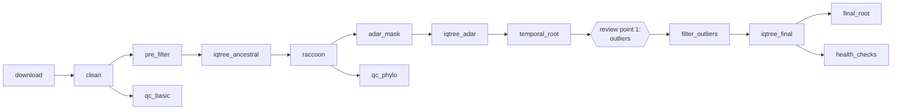

# BDBV Phylogenetic Pipeline

**Download, clean and build maximum-likelihood phylogenies from Bundibugyo ebolavirus (BDBV) genomes**

A [Nextflow](https://www.nextflow.io/) pipeline for downloading Bundibugyo ebolavirus (BDBV) genome sequences from [Pathoplexus](https://pathoplexus.org), cleaning and quality-checking them, handling ADAR-edited genomes, and building a temporally rooted maximum-likelihood tree. It can be run as an initial run on a fresh download, or as an update run that also compares the new dataset with a previous one. Every step runs in a Docker container by default.

## Pipeline overview

The pipeline works through the following stages:

1. **Download** *(`download`)* — fetch the aligned sequences and metadata from Pathoplexus. Skipped if you provide `--fasta` and `--metadata`.
2. **Align** *(`mafft`, optional, `--mafft`)* — [MAFFT](https://mafft.cbrc.jp/alignment/software/) alignment, only needed for unaligned input. Pathoplexus sequences are already aligned.
3. **Clean** *(`clean`)* — rename headers, trim, mask any specified sites (`--mask_sites`), deduplicate versions, standardise locations using the aliases file and apply the date filter.
4. **Basic QC** *(`qc_basic`)* — genome-level QC report.
5. **Pre-filter** *(`pre_filter`)* — remove sequences in the manual and pending exclusion lists.
6. **Initial tree** *(`iqtree_ancestral`)* — [IQ-TREE](http://www.iqtree.org/) ML tree with ModelFinder (or a fixed `--model`) and ancestral state reconstruction.
7. **ADAR identification** *(`raccoon`)* — identify ADAR-edited sites with [raccoon](https://github.com/artic-network/raccoon).
8. **ADAR handling** *(`adar_mask`)* — mask the ADAR sites, or exclude affected genomes (`--adar_mode`).
9. **Phylogenetic QC** *(`qc_phylo`)* — phylogeny-based QC report.
10. **Rebuild tree** *(`iqtree_adar`)* — IQ-TREE on the ADAR-handled alignment, using the model found in step 6.
11. **Temporal rooting** *(`temporal_root`)* — best-fitting temporal root and outlier detection (**review point 1**).
12. **Outlier removal** *(`select_outliers`, `filter_outliers`)* — remove temporal outliers, either automatically or from a file you have reviewed (**review point 1**).
13. **Final tree** *(`iqtree_final`, `final_root`)* — final ML tree with aBayes branch support, temporally rooted.
14. **Health checks** *(`health_checks`, update runs only)* — compare with a previous dataset and flag problem genomes (update runs only).



## Installation

Install [Nextflow](https://www.nextflow.io/) (≥ 23.04) and [Docker](https://www.docker.com/products/docker-desktop), then clone this repository:

```bash
git clone https://github.com/rmcolq/bdbv-pipeline-nf.git
cd bdbv-pipeline-nf
```

No other setup is needed. The pipeline pulls the [`articnetworkorg/bdbv-pipeline`](https://hub.docker.com/r/articnetworkorg/bdbv-pipeline) image from Docker Hub automatically, and it contains everything the pipeline needs, including IQ-TREE. Docker is the default (`-profile standard`). Other options:

| Option | Use |
|--------|-----|
| `-profile singularity` | Run the steps in Singularity instead of Docker |
| `-profile conda` | Create the environment from `environment.yml` rather than using a container. IQ-TREE is not available through conda on every platform; if it fails to install, use a container instead |
| `--wf.container_version TAG` | Use a different image tag, e.g. your own build: `docker build -t articnetworkorg/bdbv-pipeline:dev .` then `--wf.container_version dev` |

## Running the pipeline

### Initial run

Downloads from Pathoplexus, builds the tree, automatically removing outliers with |z| ≥ 3:

```bash
nextflow run . \
    --outdir data/YYYYMMDD \
    --scope drc \
    --min_date 2026-05-01 \
    --adar_mode mask \
    --outlier_removal_threshold 3
```

To use files you have already downloaded, add `--fasta data/YYYYMMDD/aligned.fasta --metadata data/YYYYMMDD/metadata.tsv`. Use `--mafft` if the sequences are not already aligned.

`--scope` options:
- `drc` — DRC sequences only (applies the Pathogen Genomic Lab group filter)
- `drc,kenya` — DRC + Kenya
- `outbreak` — all current outbreak countries (DRC, Kenya, Uganda)

Output file names start with `--prefix`, which defaults to `bdbv_<run_name>` (for example `bdbv_20261026`). `--run_name` defaults to today's date, `YYYYMMDD`.

### Update run

As the initial run, plus `--previous_data` to run health checks against the previous dataset:

```bash
nextflow run . \
    --outdir data/YYYYMMDD \
    --previous_data data/YYYYMMDD_previous \
    --outlier_removal_threshold 3
```

The report is written to `health_checks/health_check_report.txt`. Unlike the Python `bin/run.py` script, the pipeline never edits files in `data/`. It writes suggestions for you to review and merge yourself:

- `health_checks/exclude_pending.additions.txt` — new `duplicate_sample` flags to add to `data/exclude_pending.txt`
- `health_checks/retractions.additions.txt` — retracted accessions to add to your `retractions.txt`

### Manual review points and resuming

There is a place where you may want to stop and review before continuing. The pipeline stops and prints the command to resume at the end of the run. Resume with `-resume` so completed steps are reused from the cache.

> **Resuming on a later day:** `--run_name` defaults to today's date, so a resume the next day changes the prefix and reruns cached steps. Set `--run_name` explicitly (e.g. `--run_name 20261026`) on every command for a run you plan to resume, and keep the same `--outdir` and input parameters.

**1. Outliers (after temporal rooting).** If you do not set `--outlier_removal_threshold`, the pipeline stops after temporal rooting. Review the RTT plot and `<prefix>.ADAR_masked.outliers.txt` in `temporal_root/`, copy the outliers file and edit the copy, then resume with it:

```bash
nextflow run . <same parameters> -resume --outlier_file my_outliers.txt
```

Health checks (update runs) are the final step. Review `health_checks/health_check_report.txt` and update the exclusion lists. If something must be excluded, rerun with the updated `data/exclude_pending.txt`; the tree steps rerun because the input of `pre_filter` has changed.

## Output files

All outputs are written under `--outdir`, one folder per step:

| Folder | Contents |
|--------|----------|
| `download/` | Pathoplexus FASTA and metadata |
| `clean/` | Cleaned alignment and cleaning log |
| `to_review/` | QC reports (`qc_report_basic.txt`, `qc_report_phylo.txt`) and `missing_aliases.txt` |
| `iqtree_initial/` | First tree, ancestral states and best-fit model |
| `raccoon/` | raccoon ADAR identification outputs |
| `adar/` | ADAR-masked (or ADAR-excluded) alignment and ADAR report |
| `iqtree_adar/` | Tree rebuilt on the ADAR-handled alignment |
| `temporal_root/` | Rooted tree, RTT plot and detected outliers (`outliers.txt` when auto-removed) |
| `final/` | Final alignment, ML tree with aBayes support and temporally rooted tree |
| `health_checks/` | Health check report and suggested exclusions and retractions (update runs) |
| `intermediates/` | MAFFT and pre-filtered alignments (only with `--output_intermediates`) |
| `execution/` | Nextflow timeline, report and trace |

`to_review/missing_aliases.txt` is only written when the cleaning step finds `admin2` locations that are not in `data/aliases.csv`. Add them to the aliases file and rerun.

## Parameters

Parameters are given on the command line as `--name value`. See `nextflow_schema.json` for the full definitions.

### Input options

| Parameter | Description | Default |
|-----------|-------------|---------|
| `--fasta` | Aligned FASTA (or unaligned with `--mafft`). If unset, sequences are downloaded from Pathoplexus | |
| `--metadata` | Pathoplexus metadata TSV. Required with `--fasta` | |
| `--mafft` | Align sequences with MAFFT before cleaning | `false` |
| `--organism` | LAPIS organism slug used for download | `ebola-bdbv` |
| `--scope` | Countries to download: `drc`, a comma-separated list such as `drc,kenya`, or `outbreak` | `drc` |
| `--previous_data` | Previous run folder to compare against in health checks. Health checks are skipped when unset | |

### Output options

| Parameter | Description | Default |
|-----------|-------------|---------|
| `--outdir` | Folder for all output files | `output` |
| `--prefix` | Prefix for output file names | `bdbv_<run_name>` |
| `--run_name` | Label used in download file names, the default prefix and retractions | today, `YYYYMMDD` |

### Design options

| Parameter | Description | Default |
|-----------|-------------|---------|
| `--min_date` | Remove sequences dated before this (`YYYY-MM-DD`). Sequences from the same year but before this date are flagged | |
| `--model` | Substitution model (e.g. `GTR+F+R3`) instead of running ModelFinder | |
| `--adar_mode` | `mask` masks ADAR sites; `exclude_tc` excludes T>C genomes; `exclude_all` excludes T>C/A>G/G>A genomes. Health checks currently only work with `mask` | `mask` |
| `--outlier_removal_threshold` | Auto-remove temporal outliers with \|z\| ≥ this value and continue. If neither this nor `--outlier_file` is given, the pipeline stops after temporal rooting for review | |
| `--full_health_check` | Run health checks on all genomes, not just new ones | `false` |

### Review options

| Parameter | Description | Default |
|-----------|-------------|---------|
| `--outlier_file` | Reviewed outlier file; continues from outlier filtering (see [review point 1](#manual-review-points-and-resuming)) | |
| `--output_intermediates` | Also publish the MAFFT and pre-filtered alignments to `intermediates/` | `false` |

### Additional options

These are available, but the presets are recommended.

| Parameter | Description | Default |
|-----------|-------------|---------|
| `--trim_start`, `--trim_end` | First and last alignment positions to keep (1-based, inclusive) | |
| `--seed` | IQ-TREE random seed | `42` |
| `--aliases_file` | CSV mapping observed `admin2` location names to canonical names | `data/aliases.csv` |
| `--mask_sites` | Comma-separated 1-based positions to mask to N (e.g. `5246,5249,5251`) | |
| `--mask_sites_file` | File of 1-based positions to mask, one per line (`#` comments allowed) | |
| `--exclude_file` | Accessions to always exclude from analysis | `data/exclude.txt` |
| `--exclude_pending` | Accessions temporarily excluded while under review | `data/exclude_pending.txt` |

## Data files

- **`data/aliases.csv`** — maps observed `admin2` location names to canonical names. Update it periodically as new sequences with novel location spellings are submitted (the pipeline lists any it does not recognise in `to_review/missing_aliases.txt`).
- **`data/exclude.txt`** — accessions to always exclude from analysis (e.g. non-consortium sequences). `data/exclusion_log.tsv` records why sequences were excluded.
- **`data/mask_sites.txt`** — alignment positions currently masked, and why. Pass it with `--mask_sites_file`.
- **`data/exclude_pending.txt`** — accessions temporarily excluded while under review (e.g. flagged `duplicate_sample` by the health checks).

## Health checks

The health checks compare the current and previous runs. Per-sequence flags: `high_adar`, `high_Ns`, `low_coverage`, `near_outlier`, `many_gaps`, `long_branch`, `duplicate_sample`, `phylo_conflict`. Dataset-level checks: outlier count, clock rate shift, R², ADAR branch count, genome count and version changes or retractions.

## Running the Python scripts without Nextflow

The steps are also available as standalone Python scripts in `bin/`, which can be run directly. Create the conda environment first:

```bash
conda env create -f environment.yml
conda activate bdbv-pipeline
```

`environment.yml` includes IQ-TREE 3, which conda can't install on every platform. If it fails on yours, remove that line and install [IQ-TREE 2/3](http://www.iqtree.org/) separately, available on `PATH` as `iqtree3`. `raccoon` requires `baltic<1`, which is pinned in `environment.yml`.

**Download sequences:**

```bash
python bin/download_pathoplexus.py --scope drc -o data/YYYYMMDD
```

**Run the pipeline** (stops after temporal rooting for outlier review unless `--outlier-removal-threshold` is given; resume with `--skip-to filter_outliers`):

```bash
python bin/run_pipeline.py \
    -f data/YYYYMMDD/aligned.fasta \
    -m data/YYYYMMDD/metadata.tsv \
    -p data/YYYYMMDD/prefix \
    --min-date 2026-05-01 \
    --exclude-file data/exclude.txt \
    --mask-sites-file data/mask_sites.txt \
    --adar-mode mask \
    --outlier-removal-threshold 3
```

**Run the full workflow in one command** (download → quality report → pipeline → health checks; unlike the Nextflow pipeline this appends `duplicate_sample` flags to `data/exclude_pending.txt` itself):

```bash
python bin/run.py --previous-data data/20260915 --outdir data/YYYYMMDD --prefix BDBV2026.outbreak --scope outbreak
```

**Run health checks:**

```bash
python bin/health_checks.py --current data/20261012 --previous data/20260915 --prefix Ituri2026.DRC_trimmed
```
